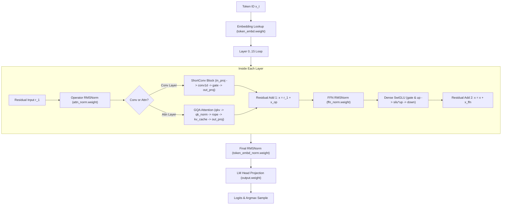

# LFM2.5-1.2B-Thinking Architecture & Execution Specification

This document provides the complete architectural breakdown, mathematical execution pipeline, tensor inventory, and memory budget for **LFM2.5-1.2B-Thinking** within the [`tuf`](file:///home/nii/workspace/tuf) inference runtime.

---

## 1. Model Overview & Hyperparameters

* **Model File**: `unsloth/LFM2.5-1.2B-Thinking-GGUF/LFM2.5-1.2B-Thinking-Q4_K_M.gguf`
* **File Size**: **694.8 MiB** (730,895,584 bytes on disk)
* **Architecture**: `lfm2` (Dense Hybrid Conv1D + GQA Attention)
* **Total Layers**: **16 blocks**
* **Active Parameters**: 1.2 Billion (100% active per token)
* **Embedding Dimension ($d$)**: 2048
* **Context Length**: 128,000 tokens
* **Vocabulary Size**: 65,536 tokens
* **Attention Heads**: 32 Query Heads, 8 KV Heads ($d_{\text{head}} = 64$)
* **ShortConv Window ($K$)**: 3 (rolling state buffer = 2 past tokens per channel)
* **FFN Intermediate Dimension**: 8,192 (SwiGLU)
* **RMS Norm Epsilon**: $1 \times 10^{-5}$
* **Target Hardware Footprint**: **100% resident in GPU VRAM** (~695 MiB on 8 GB RTX 3070, leaving >7 GiB free).

---

## 2. Layer Composition Breakdown

The 16 blocks are arranged in an interleaved hybrid structure:

| Block Index | Operator Type | FFN Type | Notes |
| :--- | :--- | :--- | :--- |
| **Layer 0** | **ShortConv1D** ($K=3$) | Dense SwiGLU ($2048 \to 8192 \to 2048$) | Rolling conv state initialized to 0 |
| **Layer 1** | **ShortConv1D** ($K=3$) | Dense SwiGLU | |
| **Layer 2** | **GQA Attention** (32 Q, 8 KV) | Dense SwiGLU | First KV cache layer |
| **Layer 3** | **ShortConv1D** ($K=3$) | Dense SwiGLU | |
| **Layer 4** | **ShortConv1D** ($K=3$) | Dense SwiGLU | |
| **Layer 5** | **GQA Attention** (32 Q, 8 KV) | Dense SwiGLU | Second KV cache layer |
| **Layer 6** | **ShortConv1D** ($K=3$) | Dense SwiGLU | |
| **Layer 7** | **ShortConv1D** ($K=3$) | Dense SwiGLU | |
| **Layer 8** | **GQA Attention** (32 Q, 8 KV) | Dense SwiGLU | Third KV cache layer |
| **Layer 9** | **ShortConv1D** ($K=3$) | Dense SwiGLU | |
| **Layer 10** | **GQA Attention** (32 Q, 8 KV) | Dense SwiGLU | Fourth KV cache layer |
| **Layer 11** | **ShortConv1D** ($K=3$) | Dense SwiGLU | |
| **Layer 12** | **GQA Attention** (32 Q, 8 KV) | Dense SwiGLU | Fifth KV cache layer |
| **Layer 13** | **ShortConv1D** ($K=3$) | Dense SwiGLU | |
| **Layer 14** | **GQA Attention** (32 Q, 8 KV) | Dense SwiGLU | Sixth KV cache layer |
| **Layer 15** | **ShortConv1D** ($K=3$) | Dense SwiGLU | Final transformer block |

* **Total Conv Layers**: 10 layers (`[0, 1, 3, 4, 6, 7, 9, 11, 13, 15]`)
* **Total Attention Layers**: 6 layers (`[2, 5, 8, 10, 12, 14]`)
* **Total Dense FFN Layers**: 16 layers (All layers)

---

## 3. Mathematical Execution Pipeline (Token-by-Token)

### 3.1 Step 1: Embedding Lookup
Given input token ID $w_t \in [0, 65535]$:
$$\mathbf{x}_0 = \text{DequantizeRow}(\text{token\_embd.weight}, w_t) \in \mathbb{R}^{2048}$$

### 3.2 Step 2: Layer Execution ($l = 0 \dots 15$)

#### Operator RMSNorm:
$$\mathbf{x}_{\text{norm}} = \text{RMSNorm}(\mathbf{x}, \mathbf{w}_{\text{attn\_norm}}^{(l)})$$

#### Branch A: Short-Convolution ($l \in \text{conv\_layers}$)
1. **Input Projection**:
   $$\mathbf{y} = \mathbf{x}_{\text{norm}} \cdot \mathbf{W}_{\text{in\_proj}}^{(l)} \in \mathbb{R}^{6144}$$
   Split into three chunks of size 2048:
   $$\mathbf{b} = \mathbf{y}[0:2048], \quad \mathbf{c} = \mathbf{y}[2048:4096], \quad \mathbf{v} = \mathbf{y}[4096:6144]$$
2. **Channel Modulation**:
   $$\mathbf{u} = \mathbf{b} \odot \mathbf{v}$$
3. **Causal 1D Depthwise Convolution**:
   With rolling state $\mathbf{S}^{(l)} \in \mathbb{R}^{2 \times 2048}$ holding past two tokens $\mathbf{u}_{t-2}, \mathbf{u}_{t-1}$:
   $$\mathbf{o}[i] = \mathbf{S}^{(l)}[0, i] \cdot \mathbf{K}^{(l)}[0, i] + \mathbf{S}^{(l)}[1, i] \cdot \mathbf{K}^{(l)}[1, i] + \mathbf{u}[i] \cdot \mathbf{K}^{(l)}[2, i]$$
   Update rolling state:
   $$\mathbf{S}^{(l)}[0, i] \leftarrow \mathbf{S}^{(l)}[1, i], \quad \mathbf{S}^{(l)}[1, i] \leftarrow \mathbf{u}[i]$$
4. **Output Gating**:
   $$\mathbf{g} = \mathbf{c} \odot \mathbf{o}$$
5. **Output Projection**:
   $$\mathbf{x}_{\text{op}} = \mathbf{g} \cdot \mathbf{W}_{\text{out\_proj}}^{(l)} \in \mathbb{R}^{2048}$$

#### Branch B: GQA Attention ($l \in \text{attn\_layers}$)
1. **Projections**:
   $$\mathbf{Q} = \mathbf{x}_{\text{norm}} \cdot \mathbf{W}_q \in \mathbb{R}^{32 \times 64}, \quad \mathbf{K} = \mathbf{x}_{\text{norm}} \cdot \mathbf{W}_k \in \mathbb{R}^{8 \times 64}, \quad \mathbf{V} = \mathbf{x}_{\text{norm}} \cdot \mathbf{W}_v \in \mathbb{R}^{8 \times 64}$$
2. **Per-Head QK-Norm**:
   $$\mathbf{Q}_h = \text{RMSNorm}(\mathbf{Q}_h, \mathbf{w}_{\text{q\_norm}}), \quad \mathbf{K}_k = \text{RMSNorm}(\mathbf{K}_k, \mathbf{w}_{\text{k\_norm}})$$
3. **Rotary Position Embedding (RoPE)**:
   Apply RoPE ($\theta = 10^7$) to $\mathbf{Q}$ and $\mathbf{K}$ at position $t$.
4. **KV Cache Append & Softmax Attention**:
   Store $\mathbf{K}, \mathbf{V}$ in slot $t$. Compute Grouped-Query Softmax with scale factor $\frac{1}{\sqrt{64}} = 0.125$.
5. **Output Projection**:
   $$\mathbf{x}_{\text{op}} = \mathbf{A} \cdot \mathbf{W}_{\text{output}} \in \mathbb{R}^{2048}$$

#### Residual Add 1:
$$\mathbf{x} = \mathbf{x} + \mathbf{x}_{\text{op}}$$

#### Dense SwiGLU FFN:
1. **FFN Norm**: $\mathbf{x}_{\text{f\_norm}} = \text{RMSNorm}(\mathbf{x}, \mathbf{w}_{\text{ffn\_norm}}^{(l)})$
2. **Gate & Up Projections**:
   $$\mathbf{gate} = \mathbf{x}_{\text{f\_norm}} \cdot \mathbf{W}_{\text{gate}} \in \mathbb{R}^{8192}, \quad \mathbf{up} = \mathbf{x}_{\text{f\_norm}} \cdot \mathbf{W}_{\text{up}} \in \mathbb{R}^{8192}$$
3. **SwiGLU Activation**:
   $$\mathbf{act} = \text{SiLU}(\mathbf{gate}) \odot \mathbf{up} = \left(\frac{\mathbf{gate}}{1 + e^{-\mathbf{gate}}}\right) \odot \mathbf{up}$$
4. **Down Projection**:
   $$\mathbf{x}_{\text{ffn}} = \mathbf{act} \cdot \mathbf{W}_{\text{down}} \in \mathbb{R}^{2048}$$
5. **Residual Add 2**:
   $$\mathbf{x} = \mathbf{x} + \mathbf{x}_{\text{ffn}}$$

### 3.3 Step 3: Final Output Projection
1. **Final RMSNorm**:
   > [!NOTE]
   > Liquid AI GGUFs key the final RMSNorm tensor as **`token_embd_norm.weight`**!
   $$\mathbf{x}_{\text{final}} = \text{RMSNorm}(\mathbf{x}, \mathbf{w}_{\text{token\_embd\_norm}})$$
2. **LM Head**:
   $$\text{logits} = \mathbf{x}_{\text{final}} \cdot \mathbf{W}_{\text{output}} \in \mathbb{R}^{65536}$$

---

## 4. Complete Tensor Inventory (148 Tensors)

| Tensor Group | Tensor Name Pattern | Shape | Quant Type | Count |
| :--- | :--- | :--- | :---: | :---: |
| **Embeddings & Output** | `token_embd.weight` | `(2048, 65536)` | `Q6_K` | 1 |
| | `token_embd_norm.weight` *(Final Norm)* | `(2048,)` | `F32` | 1 |
| | `output.weight` | `(2048, 65536)` | `Q6_K` | 1 |
| **Layer Norms** | `blk.N.attn_norm.weight` | `(2048,)` | `F32` | 16 |
| | `blk.N.ffn_norm.weight` | `(2048,)` | `F32` | 16 |
| **ShortConv Blocks (10 layers)** | `blk.N.shortconv.in_proj.weight` | `(2048, 6144)` | `Q4_K` | 10 |
| | `blk.N.shortconv.conv.weight` | `(3, 2048)` | `F32` | 10 |
| | `blk.N.shortconv.out_proj.weight` | `(2048, 2048)` | `Q4_K` | 10 |
| **Attention Blocks (6 layers)** | `blk.N.attn_q.weight` | `(2048, 2048)` | `Q4_K` | 6 |
| | `blk.N.attn_k.weight` | `(2048, 512)` | `Q4_K` | 6 |
| | `blk.N.attn_v.weight` | `(2048, 512)` | `Q6_K` | 6 |
| | `blk.N.attn_output.weight` | `(2048, 2048)` | `Q4_K` | 6 |
| | `blk.N.attn_q_norm.weight` | `(64,)` | `F32` | 6 |
| | `blk.N.attn_k_norm.weight` | `(64,)` | `F32` | 6 |
| **Dense FFN Blocks (16 layers)** | `blk.N.ffn_gate.weight` | `(2048, 8192)` | `Q4_K` | 16 |
| | `blk.N.ffn_up.weight` | `(2048, 8192)` | `Q4_K` | 16 |
| | `blk.N.ffn_down.weight` | `(8192, 2048)` | `Q6_K` | 16 |
| **Total** | | | | **148** |

---

## 5. Performance Roofline & Optimization Strategy

* **Model VRAM Footprint**: 694.8 MiB.
* **Rolling Conv State**: $10 \text{ layers} \times 2 \times 2048 \times 4 \text{ bytes} = 160 \text{ KiB}$ (negligible).
* **KV Cache (4K Context)**: $6 \text{ layers} \times 2 \times 8 \times 64 \times 4096 \times 2 \text{ bytes} \approx 48 \text{ MiB}$.
* **Theoretical Peak**: $\frac{695\text{ MiB}}{330\text{ GB/s}} \approx 2.1\text{ ms/tok} \implies \mathbf{475\text{ tok/s}}$.
* **Target with Single Static CUDA Graph**: **$\ge 350 - 400$ tok/s** on NVIDIA RTX 3070 Laptop.
